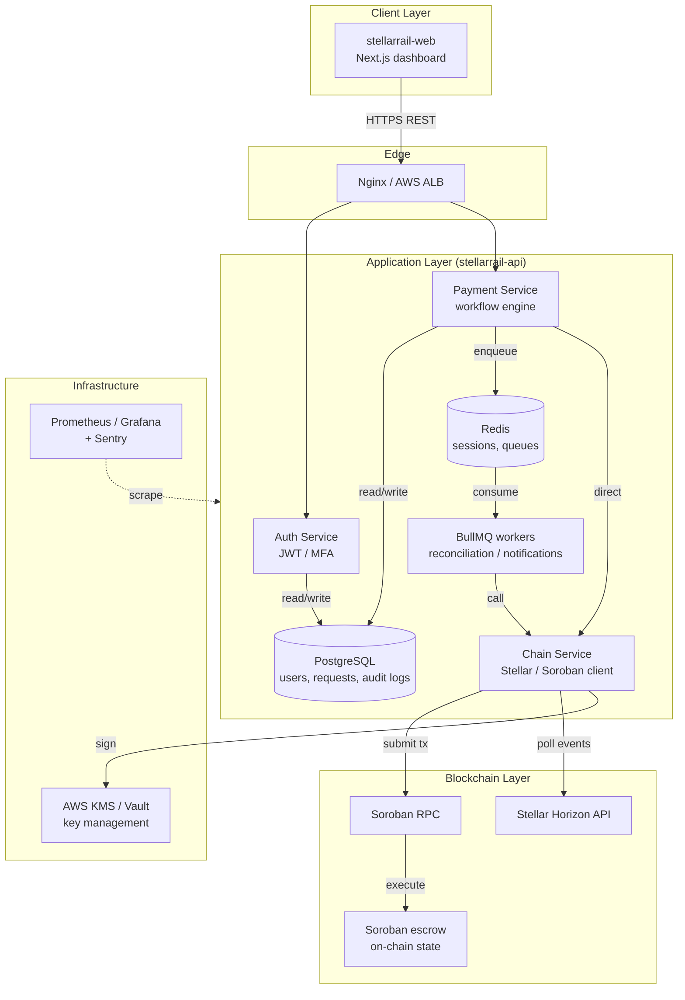

# StellarRail System Architecture (v1.0.0-rc1)

| Metadata | Value |
|---|---|
| Version | 1.0.0-rc1 |
| Last updated | 2026-10-09 |
| Scope | Component design, data flow, security model, deployment topology |
| Canonical sources | `stellarrail-api/docs/*`, `stellarrail-contracts/ARCHITECTURE.md`, `stellarrail-web/README.md` |

## 1. Overview

StellarRail is a **microservices-lite** payment-operations platform across
three repositories. It prioritizes **security** (hybrid custody + Soroban
escrow) and **observability** (hash-chained audit logs + reconciliation).

Key principles:

1. **Separation of concerns** — UI, business logic, and chain state are decoupled.
2. **Event-driven consistency** — Postgres state is synced with on-chain
   events via BullMQ workers.
3. **Zero-trust signing** — the API never holds raw keys longer than
   necessary; signing goes through KMS/Vault (local signer only for dev).
4. **Idempotency** — `Idempotency-Key` header/body prevents double-spend
   on retries (24 h window, conflict → `409 IDEMPOTENCY_CONFLICT`).

## 2. Repositories

### 2.1 `stellarrail-web` (frontend)

- **Stack:** Next.js 15.5.27 (App Router, `output: standalone`), React 18,
  TypeScript 5.4 strict, TanStack Query 5 (server state) + Zustand 4
  (client state), Tailwind 3.4 + shadcn/UI, `react-hook-form` + Zod,
  `next-intl`, Sentry.
- **Routes:** `/` dashboard home; `(auth)/login`, `(auth)/mfa`;
  `(dashboard)/payments`, `/payments/new`, `/payments/[id]`,
  `/approvals`, `/approvals/history`,
  `/admin/{users,limits,network,health,audit}`, `/account`, `/notifications`, `/403`.
- **Responsibilities:** role-gated dashboards, JWT session handling,
  form validation, realtime/polling status, mock mode via MSW
  (`NEXT_PUBLIC_USE_MOCK=true`, 12 seeded payments).

### 2.2 `stellarrail-api` (backend)

- **Stack:** Node 20, NestJS 10, Postgres 15 (Prisma 5), Redis 7
  (BullMQ 5 queues), `stellar-sdk` v11, JWT (15 min access + 7 day
  rotating refresh), TOTP MFA (`otplib`), Throttler, Helmet, Pino,
  `prom-client`.
- **Modules:** `Health`, `Users`, `Auth`, `Payments`, `Chain`, `Workers`,
  `Audit`, `Notifications`, `Admin`.
- **Responsibilities:** `POST /api/v1/payments` + approve/reject/retry/refund
  workflow (SoD enforced), KMS signing, Soroban/Horizon sync,
  reconciliation runs, hash-chained audit logs, CSV/JSON export.
- **Notable models:** `User`, `PaymentRequest` (statuses `DRAFT … SETTLED /
  REFUNDED / FAILED / EXPIRED / TIMEOUT`), `AuditLog(prevHash/hash)`,
  `IdempotencyKey`, `BlockedAddress`, `SystemConfig`, `ReconciliationRun`.

### 2.3 `stellarrail-contracts` (Soroban escrow)

- **Stack:** Rust 1.97.1, Soroban SDK 28, `stellar-cli` 27.1.0,
  WASM ~20 KiB (`target/wasm32v1-none/release/escrow.wasm`).
- **Frozen v1 entrypoints:** `initialize`, `deposit`, `release`, `refund`,
  `expire`, `get_request`, `list_requests`, `get_stats`, `set_paused`,
  `transfer_admin`, `accept_admin`, `set_signer`, `version (=1)`, `migrate`.
- **Networks:** testnet
  `CDAV32AHVV6Q7FFNPUFA76AARTGWBE2QFIU3WAPDV64QIBRTGUFKLU2K`
  (admin `GALQ…DMP`, signer `GBID…KW`); mainnet `pilot-pending`.
- Any interface change requires an ADR (`docs/adr/`).

## 3. Component diagram

## 4. Data flow — payment lifecycle

1. **Initiation (Operator):** form in web → `POST /api/v1/payments`
   (with `Idempotency-Key`). API validates address/amount/blocklist/limits,
   creates `CREATED` row, builds unsigned `deposit()` envelope.
2. **Locking (system):** signer module (KMS) signs → submits to Soroban RPC
   → `FundsLocked` event → DB `LOCKED_IN_ESCROW → PENDING_APPROVAL` →
   approvers notified.
3. **Approval (Approver):** `POST /api/v1/payments/:id/approve` (SoD:
   approver ≠ requester) → `release(destination)` → `PaymentReleased` →
   `SETTLED`. Rejection → `refund()` → `REFUNDED`. Past deadline, anyone
   may call `expire()` → funds return to depositor.
4. **Reconciliation (async):** worker polls Horizon/RPC per ledger close,
   matches events to DB rows, flags mismatches (`needsReview`), writes
   `ReconciliationRun` + audit entries.

## 5. Security model

- **Keys (hybrid custody):** hot-wallet signing via KMS/Vault; humans cannot
  extract keys; quarterly rotation; `PRIVATE_KEY`/`MNEMONIC` forbidden in
  prod; `ALLOW_LOCAL_SIGNER` dev-only; mainnet gated by
  `CONFIRM_MAINNET=I_UNDERSTAND_REAL_FUNDS`.
- **Contract:** `release`/`refund` require admin-OR-signer via explicit
  `caller` param; `expire` permissionless but deadline-gated and
  pause-immune; checked arithmetic; 2-step admin rotation; `migrate`
  preserves `DataKey` state.
- **API:** per-user/IP throttling, Zod + `class-validator` inputs, Prisma
  parameterized queries, SameSite cookies, CSP/HSTS via web layer.
- **Audit:** append-only hash-chained logs (`actor, action, payloadHash, IP,
  timestamp`), exportable; GDPR `DELETE /users/me` anonymizes.

## 6. Deployment topology

| Env | Purpose | Stellar network | Data |
|---|---|---|---|
| Dev | Local dev | Testnet / sandbox | Fake |
| Staging | QA/UAT | Testnet | Anonymized prod-like |
| Prod | Live ops | Mainnet (gated pilot) | Real funds |

Reference (AWS): ECS Fargate (API + workers), RDS Postgres Multi-AZ with
PITR, ElastiCache Redis, Secrets Manager + KMS, ECR via GitHub Actions,
CloudWatch + Prometheus/Grafana + Sentry. RPO < 1 h, RTO < 4 h. If the
backend fails, funds stay safe in escrow and can be settled via direct CLI
(see contracts `DISASTER_RECOVERY.md`).

## 7. Roadmap pointers

v1.1 USDC (SAC), batch payments; v2.0 multi-tenant org isolation; v2.1
mobile approver. Details in [`ROADMAP.md`](./ROADMAP.md).
